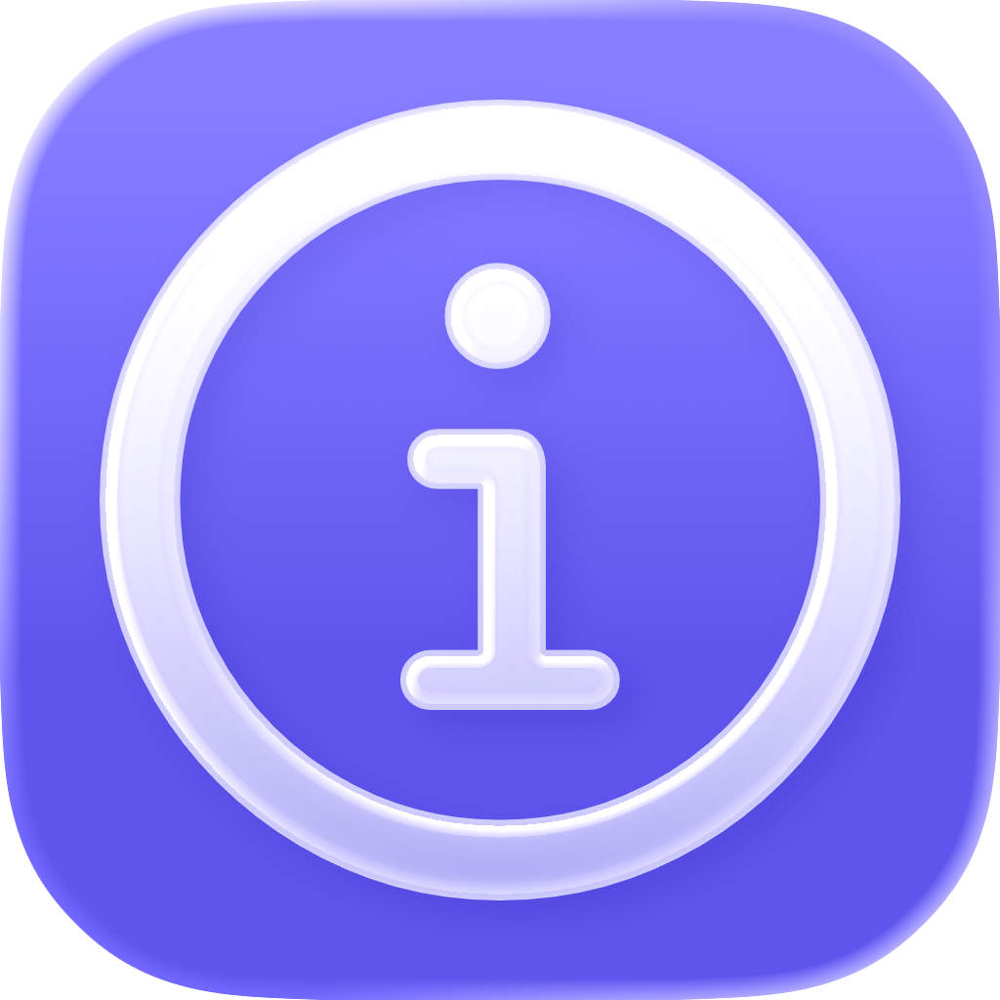
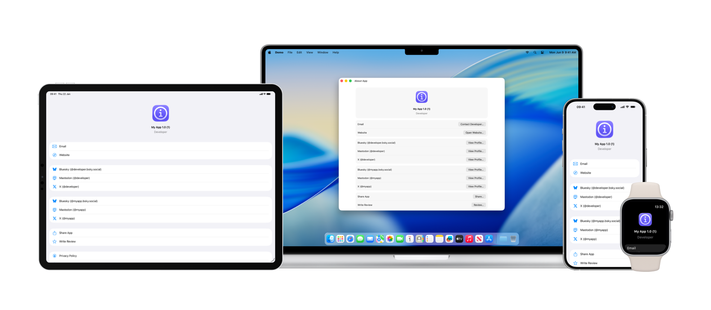

<p align="center">
    
</p>

<p align="center">
    
</p>

# AboutKit

AboutKit provides developers for Apple platforms with the ability to add an About screen to their apps. This is built using SwiftUI so can be displayed natively from a SwiftUI app or using a UIHostingController in a UIKit app.

<p align="center">
    
</p>

This has been localized into multiple languages and the buttons will automatically adapt to your appʼs accent color.

For users who previously used AboutKit for showing the features list, please use [FeaturesKit](https://github.com/adamfootdev/FeaturesKit).

1. [Requirements](#requirements)
2. [Integration](#integration)
3. [Usage](#usage)
    - [AKConfiguration](#akconfiguration)
    - [AKSection](#aksection)
    - [AKEntry](#akentry)
    - [AKMyApp](#akmyapp)
    - [AKDeveloper](#akdeveloper)
    - [AKProfile](#akprofile)
    - [AKOtherApp](#akotherapp)
    - [AKAcknowledgements](#akacknowledgements)
    - [AKPersonAcknowledgement](#akpersonacknowledgement)
    - [AKFrameworkAcknowledgement](#akframeworkacknowledgement)
    - [AboutAppView](#aboutappview)
4. [Other Packages](#other-packages)
    - [FeaturesKit](https://github.com/adamfootdev/FeaturesKit)
    - [HelpKit](https://github.com/adamfootdev/HelpKit)
    - [HapticsKit](https://github.com/adamfootdev/HapticsKit)
    - [InAppPurchaseKit](https://github.com/adamfootdev/InAppPurchaseKit)

## Requirements

- iOS/iPadOS 16.0+
- macOS 13.0+
- tvOS 16.0+
- visionOS 1.0+
- watchOS 9.0+
- Xcode 16.0+

## Integration

### Swift Package Manager

AboutKit can be added to your app via Swift Package Manager in Xcode. Add to your project like so:

```swift
dependencies: [
    .package(url: "https://github.com/adamfootdev/AboutKit.git", from: "4.0.0")
]
```

## Usage

To start using the framework, you'll need to import it first:

```swift
import AboutKit
```

### AKConfiguration

This is a struct containing all of the relevant details required to configure AboutKit. It can be created like so:

```swift
let configuration = AKConfiguration(
    app: app, 
    otherApps: otherApps, 
    showShareApp: .always, 
    showWriteReview: .always,
    emailAttachments: {
        [
            .text("Current diagnostics", fileName: "diagnostics.txt")
        ]
    }
)
```

The default section order matches the standard AboutKit layout. Supply a custom `sections` array to reorder built-in sections or insert your own sections.

`emailAttachments` is called immediately before the support-email composer is
opened, so it can generate current content asynchronously. It supports multiple
mixed attachments:

```swift
emailAttachments: {
    [
        .file(exportURL),
        .text(status, fileName: "status.txt"),
        .image(screenshot, fileName: "screenshot.png"),
        .binary(data, mimeType: "application/json", fileName: "export.json")
    ]
}
```

Return `nil` or an empty array to open the composer without attachments. AboutKit
silently skips inaccessible files, invalid values, image filenames without a
`.png` extension, and later attachments with a duplicate filename. The callback
is used by the native composer on iOS, iPadOS, and visionOS. The `mailto:` fallback
and the current macOS contact action cannot carry attachments.

### AKSection

`AKSection` controls the sections and their order in the AboutKit form. The standard order is available as `AKSection.defaultOrder`. A custom section can contain one or more `AKEntry` values:

```swift
let sections: [AKSection] = [
    .header,
    .contact,
    .custom(
        title: "Purchases",
        [purchaseEntry, tipJarEntry]
    ),
    .developerProfiles,
    .appProfiles,
    .sharingAndReview,
    .legalAndAcknowledgements,
    .testFlight,
    .otherApps
]
```

Omit `title` for an untitled custom section: `.custom([purchaseEntry])`.

Pass the order to `AKConfiguration` using its `sections` parameter.

### AKEntry

`AKEntry` can display custom SwiftUI content inline, or create a row with a title and SF Symbol that presents a destination using a navigation push or sheet. Both are available on iOS, watchOS, tvOS and visionOS; see [Platform differences](#platform-differences) for macOS:

```swift
let purchaseEntry = AKEntry.navigation(
    "Purchase Options",
    systemImage: "cart"
) {
    PurchaseOptionsView()
}

let tipJarEntry = AKEntry.sheet(
    "Tip Jar",
    systemImage: "heart"
) {
    TipJarView()
}
```

Use `.inline` to embed a view directly inside a custom section, without a button or presentation wrapper:

```swift
.custom(title: "Configuration", [
    .inline {
        Toggle("Is on?", isOn: $isOn)
    }
])
```

Here, `isOn` is state owned by the enclosing view. Inline content works on every platform and can be mixed with navigation and sheet entries in the same section.

Sheet destinations are responsible for providing any navigation container or dismissal controls they require.

#### Platform differences

On macOS the form has no navigation stack to push onto, so `.navigation` and `.sheet` behave identically: both present their destination in a sheet. Rows also match the surrounding macOS style, showing the title alongside a trailing action button rather than an SF Symbol, so `systemImage` is ignored there.

Inline entries remain embedded in the section on macOS. Every presented destination needs its own dismissal control on macOS, including those created with `.navigation`. Sheets are given a minimum size of 400×300, matching the built-in acknowledgements sheet; a destination that sets its own frame overrides this.

```swift
struct PurchaseOptionsView: View {
    @Environment(\.dismiss) private var dismiss

    var body: some View {
        #if os(macOS)
        NavigationStack {
            content
                .toolbar {
                    ToolbarItem(placement: .cancellationAction) {
                        Button("Done") { dismiss() }
                    }
                }
        }
        #else
        content
        #endif
    }
}
```

### AKMyApp

This is a struct containing details about the current app. It can be created like so:

```swift
let app = AKMyApp(
    id: "123456789", 
    name: "Example App", 
    appIcon: UIImage(named: "app-icon"), 
    developer: developer, 
    email: "exampleapp@example.com", 
    websiteURL: URL(string: "https://www.example.com")!, 
    profiles: [profile], 
    privacyPolicyURL: URL(string: "https://www.example.com/privacy-policy")!, 
    termsOfUseURL: URL(string: "https://www.example.com/terms-of-use")!, 
    testFlightURL: URL(string: "https://www.example.com/testflight")!, 
    acknowledgements: acknowledgements
)
```

If a value for the app icon is not provided, one will attempt to be downloaded from the App Store based on the provided app ID. The app ID can be found in App Store Connect or from the app's URL, e.g. <https://apps.apple.com/app/id123456789>

### AKDeveloper

This is a struct containing details about the developer belonging to the current app. It can be created like so:

```swift
let developer = AKDeveloper(
    id: "987654321", 
    name: "App Developer", 
    profiles: [profile]
)
```

The developer ID can be found by locating the App Store page that contains all of your apps e.g. <https://apps.apple.com/developer/id987654321>

### AKProfile

This is a struct containing details about about a social media profile relating to either the developer or the app itself. It supports multiple platforms such as X and Mastodon. It can be created like so:

```swift
let profile = AKProfile(
    username: "appdeveloper", 
    platform: .reddit
)
```

### AKOtherApp

This is a struct which contains details to display another app that you own and want to show in a list on the about screen. You can create one as follows:

```swift
let otherApp = AKOtherApp(
    id: "543216789",
    name: "Other App",
    appIcon: UIImage(named: "app-icon")
)
```

If a value for the app icon is not provided, one will attempt to be downloaded from the App Store based on the provided app ID. The app ID can be found in App Store Connect or from the app's URL, e.g. <https://apps.apple.com/app/id123456789>

### AKAcknowledgements

This is a struct which contains details about frameworks and people youʼd like to acknowledge. You can create one as follows:

```swift
let acknowledgements = AKAcknowledgements(
    people: [person],
    frameworks: [framework]
)
```

### AKPersonAcknowledgement

This is a struct which contains details about a person youʼd like to acknowledge. You can create one as follows:

```swift
let person = AKPersonAcknowledgement(
    name: "App Developer",
    details: "Some details about this person!",
    profiles: [profile]
)
```

### AKFrameworkAcknowledgement

This is a struct which contains details about a framework youʼd like to acknowledge. You can create one as follows:

```swift
let framework = AKFrameworkAcknowledgement(
    name: "Framework",
    details: "Some details about this framework!",
    links: [.productPage(URL(string: "https://www.example.com")!)]
)
```

### AboutAppView

Create an instance of the view using the following:

```swift
AboutAppView(configuration: configuration)
```

The view title is localized as "About App Name" using `configuration.app.name`.
The header shows the app icon followed by the version and build number.

## Other Packages

### [FeaturesKit](https://github.com/adamfootdev/FeaturesKit)

Add a features list screen to your app.

### [HelpKit](https://github.com/adamfootdev/HelpKit)

Add a help screen to your app.

### [HapticsKit](https://github.com/adamfootdev/HapticsKit)

Add haptic feedback to your app.

### [InAppPurchaseKit](https://github.com/adamfootdev/InAppPurchaseKit)

Add a subscription screen to your app.
